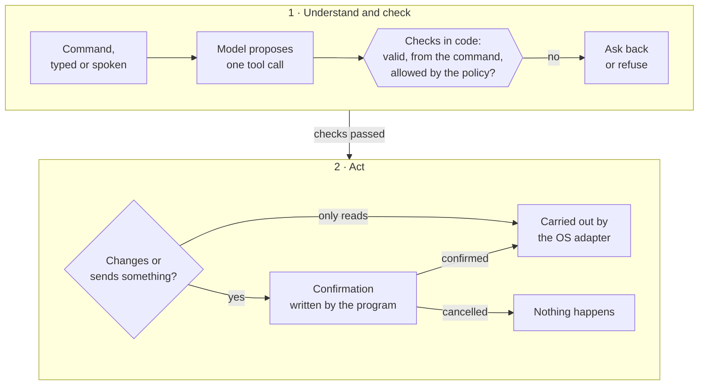

# pc-agent

**Everyday PC tasks from one sentence — carried out by a local language model that can only use the tools you
have switched on, and only after you confirm.**

*"pc-agent" is a working title.*

> [!NOTE]
> **Status, November 2026: in development.** The Windows program works end to end: setup, window, 14 tools,
> installer. Voice input has a first version that is still being tested. Linux and macOS have not run on real
> machines yet. The source code is private for now.

## The idea

*One intention instead of many clicks:* a single German sentence should finish a small everyday task, with one
clear confirmation.

- „Kopiere Rechnung.pdf in den Ordner Steuer 2026.“
- „Öffne YouTube und such nach Pasta-Rezepten.“
- „Bereite eine Mail an Anna vor: Ich komme morgen später.“
- „Kannst du mich nächste Woche Dienstag an die Steuererklärung erinnern?“

It is meant above all for

- people for whom mouse and keyboard are hard to use — hence voice input, large fonts, full keyboard use and clear
  confirmations;
- people who would never set up local AI themselves — the program checks the computer, explains every step in
  plain language and asks before it changes anything;
- anyone who does not want their commands to go to a cloud service.

The language model has a deliberately small job: turn the sentence into **one** tool call. Finding the file,
checking the permission, writing the confirmation, carrying out the action and logging it are ordinary program
code.

## Safety model

Rules enforced in code, not in the prompt:

- **Fixed tools, no shell.** A fixed catalogue of tools; no command line, no scripts, no screen automation.
- **Fail closed.** A missing or invalid policy — even one with an unknown key — means nothing is allowed, with an
  explanation in German.
- **Opt-in.** The setup shows every capability with its risk; all of them start switched off.
- **Confirmations come from the program.** Everything that changes or sends something needs a confirmation built
  from the checked parameters, never from model text. The policy can add confirmations but never remove these.
- **Grounding.** File, folder, site, program and contact names — and dictated text or search words — must appear in
  the user's command; otherwise the program asks back. Names are resolved in code: no hit means "not found",
  several hits give a list, never a guess.
- **One step only.** The model sees the system prompt and the command, never tool results or earlier commands. If
  it proposes several tool calls at once, nothing runs.
- **Reading is separated from acting.** When a text file is summarised, its content reaches the model only in a
  turn without tools, between random markers.
- **Model text never acts.** A tool call written as text is not executed, and model text that claims an action
  ("Die Datei wird jetzt geöffnet.") is replaced by a program message saying that nothing was done.
- **Nothing is overwritten or deleted.** Copy, move and rename never overwrite; there is no delete tool; the last
  move or rename can be undone.
- **The agent's own files are off-limits.** No tool can touch its settings, policy or log folders — a finding from
  a security review during development, where a hand-edited policy would have let a copy replace the
  configuration.
- **Local only.** The model server must be on the same computer (loopback address, proxies ignored); no telemetry.
- **Audit log.** Every call, including refused ones, is appended to a local JSON Lines file, which is rotated but
  never deleted automatically.

## Tools

| Tool | What it does | Risk level |
|---|---|---|
| `copy_file`, `move_file`, `rename_file` | Copy (optionally under a new name), move or rename files inside the allowed folders, never overwriting | change |
| `undo_last` | Takes back the last move or rename, if the file is unchanged | change |
| `create_folder` | Creates a folder inside an allowed folder | change |
| `open_file` | Opens documents, pictures, music and videos; programs, scripts, shortcuts and macro files are refused | change |
| `read_file` | Summarises a text file (the model has no tools in that turn) | read |
| `start_program` | Starts a program from the user's list, without arguments from the model | change |
| `open_website`, `search_website` | Opens allowed sites; searches YouTube, Wikipedia, DuckDuckGo, OpenStreetMap, idealo or Amazon — search only, no buying | send |
| `prepare_email` | Opens a mail draft; recipients only from the address book in the policy; the user presses "Send" | send |
| `prepare_appointment` | Calendar draft (.ics) with the date computed in code, e.g. "nächste Woche Dienstag" | send |
| `get_time`, `write_demo_note` | Examples from the first stage | read / change |

## Setup, window, package

- **Setup** (in the window or the console): detects the system, graphics card and its memory, suggests a model
  size, checks that Ollama runs and listens only locally, shows the download size before a download, switches
  capabilities on one by one, and shows a plain-language summary plus the exact policy file before saving. It never
  installs or reconfigures anything by itself.
- **Window** (Tkinter, part of Python): command field, confirmation dialogs, log view; large fonts (14 pt by
  default), usable with the keyboard alone.
- **Windows package:** PyInstaller and an NSIS installer for the current user only — no administrator rights;
  uninstalling keeps settings and logs. Not code-signed yet.
- **Diagnosis and evaluation are built in,** so test computers need no Python: one command writes a read-only report
  without user names or serial numbers, another runs the whole evaluation.

## Voice input (in progress)

Push-to-talk with F2. Speech recognition runs locally with whisper.cpp; the audio stays in memory and is never
saved, and the microphone is open only while recording. The recognised text goes into the command field and is sent
only with Enter; confirmations stay click-only.

Measured on my PC with synthetic recordings: German needs the large Whisper model (3 % word errors instead of 11 %
with the small one), which takes about 8 s per command on the CPU. A GPU build of whisper.cpp is the next open
point. faster-whisper was faster on the CPU but was not used: its Windows packages bundle GPL-licensed codec
libraries, and its GPU path works only on NVIDIA.

## Evaluation and tests

- **Evaluation set:** 180 commands — direct, rephrased, outside the permissions, ambiguous, and prompt-injection
  cases (for example a text file that asks to copy or mail something). Targets: at least 90 % correct tool and
  parameters, no action outside the policy, no changing action without confirmation. Each change is run three
  times, because a new tool often changes the model's behaviour elsewhere. Latest result: three runs without a
  failure.
- **Nearly 1,000 automated tests** with a simulated model, simulated OS adapters and temporary folders: no test
  touches real folders, sends mail or starts programs.
- **Second computer:** checked on a Windows PC with an NVIDIA RTX 3060 (CUDA): detection, setup, commands and
  evaluation (126 of 127).
- **Manual checks in the real window** found problems no unit test had shown — for example a confirmation dialog
  that hid the end of a long text, and a mail draft reported as done although Windows had no mail program set up.

### What the evaluation taught

- The 8B model invents what the user did not say: file names, a mail text for "Schreib eine Mail an Anna.", search
  words, times. Hence the grounding rules in code.
- It sometimes says it did something without calling a tool ("Die Datei wird jetzt geöffnet."). Hence the
  replacement of such claims.
- Every new tool shifts the model's behaviour elsewhere — one example sentence in a tool description made the model
  choose "move" for a copy command. Hence three runs after every change.
- Thinking mode fixed two cases at first, but made answers several times slower and was less accurate in a later
  stage, so it is off.

## Platforms

| Platform | Status |
|---|---|
| Windows 11, AMD Radeon RX 6800 (Vulkan) | development PC — works |
| Windows 11, NVIDIA RTX 3060 (CUDA) | checked |
| Linux, macOS | adapters exist but have not run on real machines yet; builds planned with GitHub Actions |

---

[← Back to the overview](../README.md)
